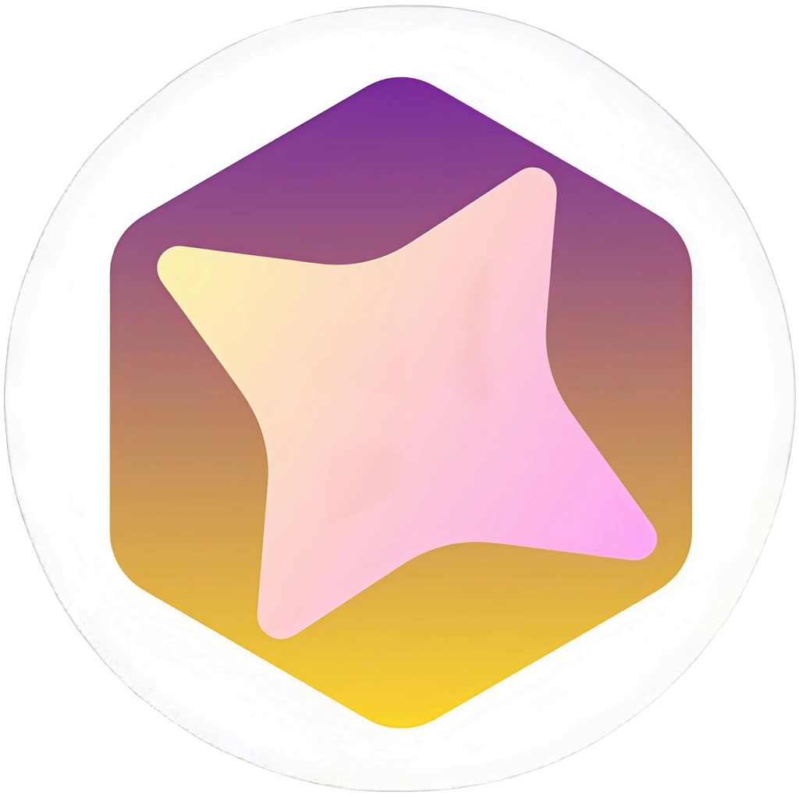

<p align="center">
  
</p>

<h1 align="center">A.I.D.P</h1>

<p align="center"><strong>AI Integrated Development Platform</strong></p>

A.I.D.P, short for AI Integrated Development Platform, is a desktop app for working with AI models from one place. You connect cloud providers with your own API keys, add local models through Ollama, and pick whichever one you want for each conversation. Everything runs on your own computer. There's no server and no account, and nothing to pay for beyond what your providers charge.

"Integrated" is the point of the name: the models and the tools you write code with sit in the same window. The main goal is the coding workspace. Open a project folder, work on it with an AI that can see your code, and let it change files or run commands only when you say so. It runs on top of the chat layer, so chat came first. A practice area for programming problems is planned after v0.1.

## Status

v0.1 is in release candidates, and the latest is 0.1.0-rc.5. Everything listed under "What v0.1 does" below is built: cloud models through OpenAI-compatible APIs and Anthropic, local models through Ollama, keys in the system keychain, the coding workspace with AI edits as diffs and agent tools that ask before every command, a terminal, attachments, themes, chat history, settings, and signed updates.

It runs on Windows, macOS and Linux. Windows is the development machine and gets the most testing. CI builds and tests all three, but the Linux and macOS builds haven't been tried by hand yet, and neither has an 8 GB RAM machine.

## Download

Get the installer for your system from the [latest release](https://github.com/Arachno-Sapien/A.I.D.P/releases/latest):

- Windows 10 or 11: `A.I.D.P_<version>_x64-setup.exe`
- macOS, Apple silicon or Intel: `A.I.D.P_<version>_universal.dmg` (not yet tested on a real Mac)
- Linux: `A.I.D.P_<version>_amd64.AppImage`, or the `.deb` for Debian and Ubuntu

The installers aren't code-signed yet, so Windows and macOS warn the first time you open the app. The [user guide](docs/user-guide.md#install) shows how to get past that. After that the app updates itself, but only when you click Install.

## What v0.1 does

- A coding workspace. Open a folder, browse it in a file tree, and edit files in tabs. An AI panel beside the editor sees the file you have open and whatever you've selected.
- AI edits you approve. Suggested changes show up as a diff, and nothing touches the disk until you accept it. Models that support tool calling can also read and search your project, ask to run commands (such as your tests), and call outside tools from stdio MCP servers you add in Settings (plus a one-click Playwright **Browser checks** preset for local web apps), one approval at a time.
- One model picker that lists cloud and local models together, with a status for each (key invalid, Ollama stopped, model not downloaded).
- Support for OpenAI-compatible APIs (OpenAI, OpenRouter, Groq, DeepSeek, Gemini's compatible endpoint, LM Studio or any custom endpoint), Anthropic, and Ollama.
- Ollama control from inside the app: detect it, start it, download models with a progress bar, delete them, and free the memory a loaded model is holding.
- Streamed replies with a Stop button, Markdown and code blocks you can copy, and chat history that survives a restart. The chat list can be hidden (Ctrl+B) or resized, and chats can be pinned, archived or deleted.
- Attachments: images, text or code files and PDFs, up to five per message, from the paperclip, a drop on the window, or a paste. Images go to models that can read them. A file's text, or a PDF's, goes in with your message.
- Themes: Dark, Light, Glass, Soft, Cyber and Elegant, or follow your system's light or dark setting.
- A small footprint. The target is under 150 MB of RAM at idle with no model loaded, so your memory goes to the models instead of the app. The installed app measures about 128 MB on Windows.

## How your API keys are handled

Keys are the one thing this app can't get wrong, so the rules are strict. A key goes into your operating system's keychain (Windows Credential Manager, macOS Keychain, or Secret Service on Linux) and nowhere else. The database only keeps the last four characters so you can tell your keys apart.

The UI hands a key over once, when you add a connection, and never gets it back. Only the Rust core reads it, and only to call that key's own provider. Keys are never logged, cloud calls have to use HTTPS, and model replies render as Markdown with raw HTML switched off, so a reply can't run scripts inside the app.

If your Linux system has no Secret Service, the app says so. It won't fall back to keeping keys in a plain file. See [docs/security.md](docs/security.md) for the full security architecture and threat model.

## What the AI is allowed to touch

Letting a model edit code and run commands is a bigger risk than storing a key, so the workspace has its own rules. The AI only sees the folder you opened. Anything outside it is refused, including paths that try to climb out with `..` or a symlink. Every change it suggests appears as a diff and is written only when you accept it, or, if you tick Review at end for a bigger task, is written as it works and listed for you to keep or undo when it finishes. Every command it wants to run shows you the exact command first and waits for you, unless you tick Run commands without asking for one task or chose Always allow for that exact command in this folder. Outside tools such as the browser ask too, unless you set that one server to run without asking. Files that look like secrets, such as `.env` files and private keys, are kept out of what the model can read unless you add them yourself.

If the folder isn't a git repository, the app warns you before the first AI edit, because there's no easy way back. Commands you type into the terminal yourself are yours and run as normal.

## How it's built

A.I.D.P is a Tauri 2 app. The frontend is React, TypeScript and Vite, styled with Tailwind, and the core is Rust. Tauri uses the WebView that already ships with the operating system instead of bundling a browser, which is why the Windows installer is under 5 MB.

The window never touches the network or the disk itself. Every request goes through the Rust core, which holds the keys, calls the providers, manages Ollama, saves chats to a local SQLite file, and does all the reading, writing and running inside your project folder. The editor is CodeMirror 6, picked over Monaco because it's much lighter. The TypeScript functions the UI calls are generated from the Rust code by tauri-specta, and CI fails if the two ever drift apart.

## Building from source

You'll need these on Windows (on macOS or Linux, see the [setup guide](docs/setup.md#building-on-macos-or-linux)):

- Node.js 22 or newer
- Rust stable with the MSVC toolchain (`rustup default stable-msvc`)
- Visual Studio Build Tools with the "Desktop development with C++" workload
- WebView2, which Windows 11 already has
- Ollama, if you want local models

Then:

```bash
git clone https://github.com/Arachno-Sapien/A.I.D.P.git
cd A.I.D.P
npm ci
npm run tauri dev
```

The first run compiles the Rust side and takes a few minutes. After that a window titled A.I.D.P opens on the Chat screen, with one button: Add a model. The [setup guide](docs/setup.md) has the longer version, including a fix for the "Filename too long" error Git sometimes hits on Windows.

To build the release app without an installer:

```bash
npm run tauri build -- --no-bundle
```

The binary ends up at `src-tauri/target/release/aidp.exe`.

## Checks

Every commit has to pass these four. CI runs the same ones on each push, and also fails if `src/lib/bindings.ts` is out of date.

```bash
cargo clippy --manifest-path src-tauri/Cargo.toml --all-targets -- -D warnings
cargo test --manifest-path src-tauri/Cargo.toml
npm run typecheck
npx vitest run
```

`cargo test` also regenerates `src/lib/bindings.ts`. Commit that file whenever it changes, and never edit it by hand.

## Project layout

```text
src/            React frontend
src-tauri/      Rust core
docs/           design doc, setup guide, milestone notes, decision records
.ai/memory/     progress notes and session logs shared by AI agents
app-icon.png    source image for the app icon
AGENTS.md       rules for anyone working on the code, human or AI
```

The full design is in [docs/design.md](docs/design.md). The reasoning behind the bigger choices, such as why Tauri and why this license, is in [docs/decisions](docs/decisions/).

## Built with AI agents

Most of the code here is written by AI coding agents, and I review every change. Several tools work on the same repo (so far Claude Code, Codex and Antigravity), and any of them can run out of tokens halfway through a task. Two things keep that from turning into a mess.

The first is [AGENTS.md](AGENTS.md). It holds the rules every agent follows: the stack, which folders each part of the code owns, the key-security rules, the checks above, and a list of things never to do. `CLAUDE.md` and `GEMINI.md` only point to it, so the rules live in one place.

The second is `.ai/memory/`. An agent claims its task in `progress.md` before it starts, keeps the next step written down while it works, and leaves a short log when it finishes. Anything that wasted time goes into `known-issues.md` so nobody repeats it. When a session stops, the next agent reads those files and carries on, whichever tool it runs in.

The repo also ships a few agent skills (Tauri, Rust, React, Vitest, plus some planning and debugging habits) in `.agents/skills/` and `.claude/skills/`. If they're missing, `npx skills experimental_install` restores them.

## Roadmap

v0.1 is split into seven milestones, and each one ends with an app that runs. The first two build the model layer the workspace needs.

1. M0, setup: app shell, checks, CI and docs. Done.
2. M1: streamed chat with one OpenAI-compatible provider, including Stop. Done.
3. M2: keys in the keychain, adding and testing providers, and Anthropic support. Done.
4. M3: the coding workspace. File tree, editor, the AI panel, and edits as diffs. Done.
5. M4: agent tools and a terminal. The model can read, search and edit files and run commands, each with your approval. Done.
6. M5: Ollama, chat history and settings. Done.
7. M6: the v0.1 release. Installers for Windows, macOS and Linux built by CI, auto-update, outside tools (MCP + Playwright Browser checks), and a test run on an 8 GB RAM machine. In progress: CI builds the installers, five release candidates are out, and outside tools (MCP client and Browser checks preset) are implemented. Still to do: live Browser checks + RAM reading with an outside server, hand checks on Linux, macOS and an 8 GB RAM machine, then 0.1.0.

After v0.1 comes the practice area.

## Contributing

It's early and the design is still moving, so please open an issue before starting anything large. The rules in AGENTS.md apply to people too: the four checks pass before a commit, no `unwrap()` outside tests, no new dependency without a reason, and docs change in the same commit as the code they describe.

## License

Licensed under either of

- Apache License, Version 2.0 ([LICENSE-APACHE](LICENSE-APACHE))
- MIT license ([LICENSE-MIT](LICENSE-MIT))

at your option.

Unless you explicitly state otherwise, any contribution intentionally submitted for inclusion in the work by you, as defined in the Apache-2.0 license, shall be dual licensed as above, without any additional terms or conditions.
